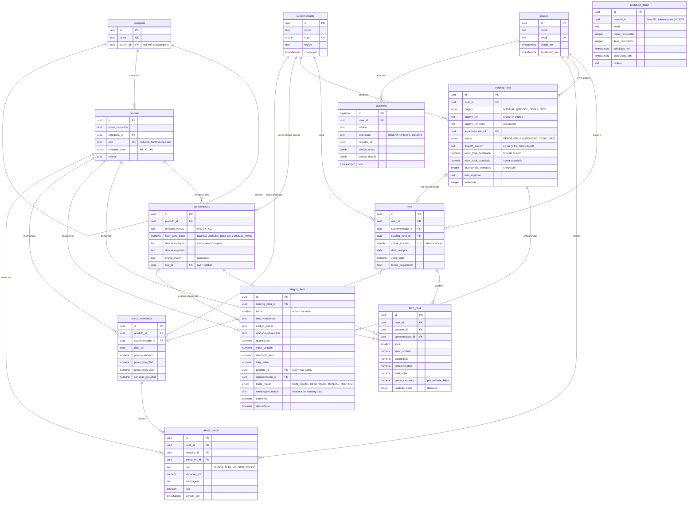

# ERD — Monitor de Preços de Supermercados

Diagrama gerado a partir do schema aplicado em PostgreSQL 16.
13 tabelas, 4 views, 24 índices, 9 triggers.

## As três decisões que o diagrama revela

**1. `apresentacao` funde de-para com conversão de unidade.**
A descrição truncada do cupom (`LEITE UHT HERC CX 12UN`) já carrega quantas unidades base tem aquela caixa. Separar "de-para" de "fator de conversão" em duas tabelas duplicaria o dado e permitiria que divergissem. Aqui ficam juntos por construção, e `loja_id` nulo = global resolve o caso de cada rede nomear o produto de um jeito.

**2. O `preco_canonico` é derivado, não digitado.**
O trigger `trg_item_nota_canonico` divide `valor_unitario` por `fator_para_base` e **recusa** gravar a linha se a apresentação não estiver resolvida. É o que impede a comparação entre redes de ser ruído — a caixa de 12 unidades e a unidade solta viram o mesmo número.

**3. O staging tem ciclo de vida próprio.**
`staging_nota` → `staging_item` → [revisão humana] → `nota` → `item_nota`. Nada entra na tabela de análise sem passar pela conferência, e a `staging_nota` original é preservada (`ON DELETE SET NULL` em `nota.staging_nota_id`) para auditoria.

## Pontos de atenção para quando você implementar

| Ponto | Por quê |
|---|---|
| `item_nota.apresentacao_id` é `NOT NULL` | Sem ela não existe base de conversão. O trigger levanta exceção em vez de gravar preço errado. |
| `chave_acesso` com índice único parcial | Uma NFC-e por usuário. Reprocessar a mesma nota não duplica. |
| `uq_produto_ean` é parcial (`WHERE ean IS NOT NULL`) | Permite vários produtos sem EAN — o caso do hortifruti a granel. |
| `exclusao_titular.usuario_id` **sem** FK | Intencional: o registro precisa sobreviver ao `DELETE` do titular. |
| `user_id` em `staging_nota`, `nota`, `alerta_preco` | Isolamento multi-tenant. Toda query da API filtra por ele. |
