# ERD — home_shopper

Generated from the schema applied on PostgreSQL 16: **22 tables, 12 views,
67 indexes, 24 triggers, 9 enums**. Measured on **2026-10-06** in a disposable
database that applied `db/001_schema.sql` … `db/016_price_window_view.sql`
in order (`information_schema.tables`, `information_schema.views`, `pg_indexes`,
`information_schema.triggers`, `pg_type`/`pg_enum` in schema `public`), and
reproduced identically on a clone of the canonical data. Every constraint is
named (`pk_`, `fk_`, `uk_`, `ck_`).

This diagram documents what is **implemented** (`db/001`–`db/016`). Migrations
`db/007`–`db/016` — category attributes and rules, the review decision on
`staging_lines`, catalogue write requests, the LGPD retention register, the
catalogue coverage after an erasure, the `users.email` constraints,
`price_refs.samples_30d`, the two variation columns of decision D9, the
presentation link on `staging_lines`, and the price window as a query (decision
D10) — are integrated into that chain.

**The price window is not in this diagram, on purpose.** `db/016` (decision D10) left
`price_refs` holding only the observation, and the aggregation over a window became a
query: `v_price_window` (one row per observation × screen preset) and `price_window()`
(one row per product/store pair, window as a parameter). See

```mermaid
erDiagram
    %% ---------- STRONG ENTITIES ----------
    users {
        uuid      id PK
        text      name
        text      email UK
        timestamptz created_at
        timestamptz updated_at
    }

    stores {
        uuid      id PK
        text      name "legal name"
        char14    cnpj UK
        char7     ibge_code "IBGE municipality"
        text      trade_name
        timestamptz created_at
    }

    categories {
        uuid      id PK
        text      name UK
        uuid      parent_id FK "self-ref: subcategory"
    }

    %% ---------- CATALOGUE ----------
    products {
        uuid      id PK
        text      name
        uuid      category_id FK
        text      brand "nullable: fresh produce"
        enum      base_unit "UN, G, ML -- smallest unit only"
        timestamptz created_at
        timestamptz updated_at
    }

    synonyms {
        uuid      id PK
        text      term
        text      expands_to
        text      scope "nullable = global"
        timestamptz created_at
    }

    presentations {
        uuid      id PK
        uuid      product_id FK
        enum      content_kind "FIXED, VARIABLE, UNKNOWN"
        numeric   content_quantity "only when FIXED"
        enum      content_unit "UN, G, ML -- reuses base_unit"
        enum      container_type "cx, pc, pct, sc, lt, un"
        integer   multipack_quantity "NULL or > 1"
        enum      sale_unit_recognized "controlled vocabulary"
        numeric   factor_base "base units per sale unit"
        enum      review_state "PENDING, CONFIRMED, NO_MATCH, SKIPPED"
        timestamptz created_at
        timestamptz updated_at
    }

    presentation_sources {
        uuid      id PK
        uuid      presentation_id FK
        uuid      store_id FK "null = global wording"
        text      sale_unit "verbatim from the receipt"
        text      description_raw "verbatim"
        text      description_search "the one derived search form"
        text      match_key "generated from description_search"
        enum      match_source "BARCODE, DESCRIPTION, ALIAS, MANUAL, NONE"
        boolean   reviewed "human-confirmed link"
        timestamptz created_at
        timestamptz updated_at
    }

    presentation_identifiers {
        uuid      id PK
        uuid      presentation_id FK
        text      gtin UK "GTIN-8/12/13/14, check digit at load time"
        boolean   reviewed "human-confirmed link"
        uuid      purchase_note_id FK "origin, NULL when multi-valued"
        smallint  line_no FK "origin, NULL when multi-valued"
        timestamptz created_at
    }

    category_attributes {
        uuid      id PK
        uuid      category_id FK
        text      attribute "snake_case key"
        text      value_kind "TEXT or BOOLEAN"
        timestamptz created_at
    }

    product_attributes {
        uuid      id PK
        uuid      product_id FK
        uuid      category_id FK
        text      attribute
        text      value_text "XOR with value_boolean"
        boolean   value_boolean "XOR with value_text"
        timestamptz created_at
        timestamptz updated_at
    }

    %% ---------- STAGING ----------
    staging_receipts {
        uuid      id PK
        uuid      user_id FK
        enum      source "MANUAL, QRCODE, SEFAZ, OCR, IMPORT"
        text      source_ref "access key, SEFAZ url"
        text      source_ref_norm "generated"
        uuid      store_id FK
        enum      status "PENDING, IN_REVIEW, DONE, DISCARDED"
        text      file_path "path only, never a BLOB"
        numeric   total_gross "receipt: Total"
        numeric   discount_total "receipt: Discount"
        numeric   amount_paid "receipt: Amount paid"
        numeric   total_computed "sum of lines, by trigger"
        integer   divergence_cents "checksum"
        text      error_message
        integer   attempts
        timestamptz created_at
        timestamptz updated_at
    }

    staging_lines {
        uuid      id PK
        uuid      receipt_id FK
        smallint  line_no
        text      description_raw
        text      store_code "emitter's 7-digit code, search aid; GS1-validated values become review candidates"
        text      sale_unit "verbatim, only non-blank"
        numeric   quantity
        numeric   unit_price
        numeric   discount_line
        numeric   line_total
        uuid      product_id FK "null = unmatched"
        uuid      presentation_id FK
        enum      match_source "BARCODE, DESCRIPTION, ALIAS, MANUAL, NONE"
        text      match_note "learning loop trail"
        boolean   reviewed
        enum      review_state "PENDING, CONFIRMED, NO_MATCH, SKIPPED"
        boolean   discarded
        timestamptz created_at
    }

    %% ---------- TRUSTED LAYER ----------
    purchase_notes {
        uuid      id PK
        uuid      user_id FK
        uuid      store_id FK
        uuid      staging_receipt_id FK
        text      access_key "partial unique: idempotency"
        date      purchase_date
        numeric   amount_paid
        timestamptz created_at
    }

    line_items {
        uuid      id PK
        uuid      note_id FK
        uuid      product_id FK
        uuid      presentation_id FK
        smallint  line_no
        numeric   unit_price
        numeric   quantity
        numeric   discount_line
        numeric   line_total
        numeric   base_price "per base unit, by trigger"
        enum      base_unit "derived by trigger"
        timestamptz created_at
    }

    %% ---------- ANALYTICS ----------
    price_refs {
        uuid      id PK
        uuid      user_id FK
        uuid      product_id FK
        uuid      store_id FK
        date      ref_date
        numeric   base_price
        enum      base_unit
        integer   samples_30d "count of observations in the 30-day window"
        numeric   price_spread_pct "max - min / min, signed"
        numeric   price_change_pct "signed, vs the previous observation; NULL when not comparable"
        timestamptz updated_at
    }

    price_alerts {
        uuid      id PK
        uuid      user_id FK
        uuid      product_id FK
        uuid      price_ref_id FK "ON DELETE SET NULL"
        text      alert_type "PRICE_DROP, PRICE_RISE, BEST_PRICE"
        numeric   var_pct
        text      message
        boolean   read
        timestamptz created_at
    }

    %% ---------- CATALOGUE WRITE / RETENTION ----------
    catalog_write_requests {
        uuid      id PK
        uuid      requested_by FK "ON DELETE SET NULL"
        text      requested_by_email
        text      kind "PRODUCT, PRESENTATION, SYNONYM, ADJUSTMENT"
        jsonb     payload
        uuid      target_id "polymorphic, no FK"
        text      justification
        enum      status "OPEN, APPROVED, REJECTED"
        uuid      reviewed_by "no FK: actor metadata"
        text      reviewed_by_email
        text      review_note
        timestamptz created_at
        timestamptz decided_at
    }
    retention_policy {
        uuid      id PK
        text      table_name
        text      column_name
        text      purpose
        text      legal_basis "CONSENT, CONTRACT, LEGITIMATE_INTEREST, LEGAL_OBLIGATION"
        integer   retention_days "NULL = no fixed term"
        timestamptz expires_at "required when retention_days IS NULL"
        timestamptz last_purged_at
        timestamptz created_at
    }

    %% ---------- LGPD / AUDIT ----------
    data_erasure_requests {
        uuid      id PK
        uuid      user_id "no FK: must outlive the DELETE"
        text      email "nullable: NULL after retention window"
        integer   notes_removed
        integer   items_removed
        timestamptz requested_at
        timestamptz executed_at
        text      reason
    }

    audit_log {
        bigserial id PK
        uuid      user_id "no FK: actor metadata"
        text      table_name
        text      operation
        uuid      record_id
        jsonb     before_data
        jsonb     after_data
        timestamptz occurred_at
    }

    %% ---------- RELATIONSHIPS ----------
    users ||--o{ purchase_notes : "makes"
    users ||--o{ staging_receipts : "submits"
    users ||--o{ price_refs : "observes"
    users ||--o{ price_alerts : "receives"
    users ||--o{ audit_log : "acts"
    users ||--o{ data_erasure_requests : "requests erasure"

    stores ||--o{ purchase_notes : "issues"
    stores ||--o{ staging_receipts : "identified in"
    stores ||--o{ presentation_sources : "writes the wording"
    stores ||--o{ price_refs : "price observed at"

    categories ||--o{ categories : "contains"
    categories ||--o{ products : "classifies"
    categories ||--o{ category_attributes : "declares"

    products ||--o{ presentations : "sold as"
    products ||--o{ product_attributes : "has values"
    products ||--o{ line_items : "bought"
    products ||--o{ staging_lines : "matched in"
    products ||--o{ price_refs : "monitored"
    products ||--o{ price_alerts : "alerts about"

    presentations ||--o{ presentation_sources : "is worded as"
    presentations ||--o{ presentation_identifiers : "is coded as"
    presentations ||--o{ line_items : "unit charged"
    presentations ||--o{ staging_lines : "unit observed"

    line_items ||--o{ presentation_identifiers : "line that declared it"

    category_attributes ||--o{ product_attributes : "constrains"

    staging_receipts ||--o{ staging_lines : "raw lines"
    staging_receipts |o--o| purchase_notes : "becomes a reviewed note"

    purchase_notes ||--|{ line_items : "contains"
    purchase_notes }o--|| price_refs : "feeds"
    price_refs ||--o{ price_alerts : "triggers"

    users ||--o{ catalog_write_requests : "requests (requested_by)"
```

`<internal record>` §3 for the contract and the measurements.

## Views

The schema defines **8 views** (plus `v_price_window` from `db/016`). They are
derived artifacts — no view stores data that is not already in a table.

| View | Purpose | Defined in |
|---|---|---|
| `v_price_aggregation` | Aggregated price per product/store | `db/002` |
| `v_current_prices` | Latest price per product/store | `db/004`, replaced `db/016` |
| `v_best_price` | Best (lowest) price per product | `db/004`, replaced `db/016` |
| `v_monthly_spend` | Monthly spend per user | `db/004` |
| `v_review_queue` | Staging lines pending review | `db/008` |
| `v_catalog_write_queue` | Approval queue grouped by status/kind | `db/009` |
| `v_retention_due` | Purge queue derived from `retention_policy` | `db/010` |
| `v_catalog_coverage` | Catalogue coverage after LGPD erasure | `db/011` |
| `v_price_window` | Price window per observation × screen preset | `db/016` |

### `v_catalog_write_queue` (`db/009`)

Approval queue for the shared catalogue. Groups `catalog_write_requests` by
`status` and `kind`, returning `request_count`, `oldest_request_at` and
`last_decision_at`. This is what a steward opens to see "how many PRODUCT
requests are waiting".

### `v_retention_due` (`db/010`)

Purge queue derived from `retention_policy`. The grain is (policy, record,
column): one audit row whose BOTH payload columns are past the window appears
twice, once per column. Every approved target is a JOIN against
`retention_policy`, so the queue is derived from the register and not from
windows hardcoded in the view. Policies with a NULL `retention_days` never
appear (no fixed term to expire), which is what keeps the trusted layer out of
the automatic purge. `target_value` is filled ONLY for the filesystem target
(the coupon path); the e-mail is deliberately NOT echoed — a compliance report
must not become a second copy of the personal data it reports about.

### `v_catalog_coverage` (`db/011`)

Catalogue coverage after an LGPD erasure. `products` has no `user_id` (ADR-0004)
and no FK points at `users`, so the product survives a user erasure — now with
no price and no history. `has_history = false` IS the orphan marker. The view
is deliberately NOT scoped by `user_id`: its whole purpose is to answer the
catalogue-level question "does ANY price history survive for this product?".
It exposes coverage aggregates only — no price, no user identity, no access key.

## The three decisions the diagram makes visible

**1. The commercial form is separate from the store's wording.**
`presentations` is the **form**: product, content, packaging, multipack, factor
and the recognised sale unit — independent of store. `presentation_sources` is
the per-store **mapping**: the verbatim text and sale unit a store prints,
pointing at one form. Two stores that word the same form differently produce two
source rows and **one** form; the uniqueness key is on the form
(`uk_presentations_form`), not on the word, so the same commercial form is never
duplicated just because a description changed.

`presentation_identifiers` holds **N GTINs per presentation**. A single
`products.ean` column was the wrong level (one product can carry different codes
per presentation) and was removed in `db/005`; the code is global to one
commercial item, so its uniqueness is over `gtin` alone.

**2. There is no store-internal product code.**
The 7-digit code on the receipt belongs to the *emitter*: the same cut of beef
carries a different code at every CNPJ, and this project exists to compare
**between** stores. A matching key that changes between the stores you want to
compare is not a key — it is confident noise. The code lives in `staging_lines`,
where it speeds up capture, and is not propagated as identity. When the printed
value passes the GS1 check (length 8/12/13/14 plus mod-10 check digit) it
becomes a **review candidate**, never a discard nor a confirmation, and the
link stays pending human review.

**3. `base_price` is derived, never typed.**
The trigger `tr_line_items_base_price` computes `unit_price / factor_base` and
**refuses** the row when the presentation is unresolved. That is what stops a
250 g pack and a 1 kg pack from being compared as if they were the same thing.
The factor lives **only** on the form, so there is no second copy to drift.

## Things to watch when implementing

| Point | Why |
|---|---|
| `line_items.presentation_id` is `NOT NULL` | Without it there is no conversion basis; the trigger raises rather than storing an uncomparable price. |
| `fk_line_items_presentation` / `fk_staging_lines_presentation` are **composite** `(presentation_id, product_id)` | The database itself guarantees the presentation belongs to the stated product. `line_items` is `RESTRICT`; `staging_lines` is `SET NULL` (staging is where the matcher errs). |
| `access_key` has a partial unique index | One NFC-e per user. Reprocessing a receipt — job retry, re-import — does not duplicate. |
| `uk_presentations_form` uses `NULLS NOT DISTINCT` | `content_quantity IS NULL` (VARIABLE/UNKNOWN) is a value; without this, one form could exist N times. |
| `ck_presentations_content` ties quantity to kind | `content_quantity` is non-null **if and only if** `content_kind = 'FIXED'`. Zero is never used for "absent". |
| `uk_products_name_brand` uses `NULLS NOT DISTINCT` | `brand IS NULL` is the normal case; without this, "CUPIM COMBO" could exist N times. |
| `presentation_sources.sale_unit` only checks non-blank | The raw receipt label (`CX 10`, `c/N`, `FRASCO`) is a fiscal fact, not a schema error. The controlled value is `presentations.sale_unit_recognized`. |
| `presentation_identifiers` provenance is one composite FK | `(purchase_note_id, line_no) → line_items(note_id, line_no)` so a note delete clears **both** columns at once; `ck_presentation_identifiers_provenance` forbids a half-truth. |
| `data_erasure_requests.user_id` has **no** FK | Intentionally: the record must survive the `DELETE` it documents. |
| `audit_log.user_id` has **no** FK | Same reason. With an FK, erasing a user aborts — reproduced before the fix. |
| `user_id` on `staging_receipts`, `purchase_notes`, `price_refs`, `price_alerts` | Tenant isolation. Every query filters on it. |
| `price_alerts.price_ref_id` is `ON DELETE SET NULL` | An alert records that a message was delivered. Recomputing prices must not erase that. |
