# ERD — home_shopper

Generated from the schema applied on PostgreSQL 16: **14 tables, 5 views,
48 indexes, 14 triggers, 4 enums**. Every constraint is named
(`pk_`, `fk_`, `uk_`, `ck_`).

```mermaid
erDiagram
    %% ---------- STRONG ENTITIES ----------
    users {
        uuid      id PK
        text      name
        text      email UK
        timestamptz created_at
        timestamptz updated_at
    }

    stores {
        uuid      id PK
        text      name
        char14    cnpj UK
        char7     ibge_code "IBGE municipality"
        text      trade_name
        timestamptz created_at
    }

    categories {
        uuid      id PK
        text      name UK
        uuid      parent_id FK "self-ref: subcategory"
    }

    %% ---------- CATALOGUE ----------
    products {
        uuid      id PK
        text      name
        uuid      category_id FK
        text      brand "nullable: fresh produce"
        text      ean UK "partial index, 0 of 42 real items"
        enum      base_unit "UN, G, ML -- smallest unit only"
        timestamptz created_at
        timestamptz updated_at
    }

    synonyms {
        uuid      id PK
        text      term
        text      expands_to
        text      scope "nullable = global"
        timestamptz created_at
    }

    presentations {
        uuid      id PK
        uuid      product_id FK
        text      sale_unit "UN, CX, KG, PC as printed"
        numeric   factor_base "base units per sale_unit"
        text      description_raw "as printed on the receipt"
        text      description_norm "lowercased"
        text      match_key "generated"
        uuid      store_id FK "null = global wording"
        timestamptz created_at
    }

    %% ---------- STAGING ----------
    staging_receipts {
        uuid      id PK
        uuid      user_id FK
        enum      source "MANUAL, QRCODE, SEFAZ, OCR, IMPORT"
        text      source_ref "access key, SEFAZ url"
        text      source_ref_norm "generated"
        uuid      store_id FK
        enum      status "PENDING, IN_REVIEW, DONE, DISCARDED"
        text      file_path "path only, never a BLOB"
        numeric   total_gross "receipt: Total"
        numeric   discount_total "receipt: Discount"
        numeric   amount_paid "receipt: Amount paid"
        numeric   total_computed "sum of lines, by trigger"
        integer   divergence_cents "checksum"
        text      error_message
        integer   attempts
        timestamptz created_at
        timestamptz updated_at
    }

    staging_lines {
        uuid      id PK
        uuid      receipt_id FK
        smallint  line_no
        text      description_raw
        text      store_code "emitter's 7-digit code, search aid only"
        text      sale_unit
        numeric   quantity
        numeric   unit_price
        numeric   discount_line
        numeric   line_total
        uuid      product_id FK "null = unmatched"
        uuid      presentation_id FK
        enum      match_source "BARCODE, DESCRIPTION, ALIAS, MANUAL, NONE"
        text      match_note "learning loop trail"
        boolean   reviewed
        boolean   discarded
        timestamptz created_at
    }

    %% ---------- TRUSTED LAYER ----------
    purchase_notes {
        uuid      id PK
        uuid      user_id FK
        uuid      store_id FK
        uuid      staging_receipt_id FK
        text      access_key "partial unique: idempotency"
        date      purchase_date
        numeric   amount_paid
        timestamptz created_at
    }

    line_items {
        uuid      id PK
        uuid      note_id FK
        uuid      product_id FK
        uuid      presentation_id FK
        smallint  line_no
        numeric   unit_price
        numeric   quantity
        numeric   discount_line
        numeric   line_total
        numeric   base_price "per base_unit, by trigger"
        enum      base_unit "derived by trigger"
        timestamptz created_at
    }

    %% ---------- ANALYTICS ----------
    price_refs {
        uuid      id PK
        uuid      user_id FK
        uuid      product_id FK
        uuid      store_id FK
        date      ref_date
        numeric   base_price
        enum      base_unit
        numeric   min_30d
        numeric   max_30d
        numeric   var_pct_30d
        timestamptz updated_at
    }

    price_alerts {
        uuid      id PK
        uuid      user_id FK
        uuid      product_id FK
        uuid      price_ref_id FK "ON DELETE SET NULL"
        text      alert_type "PRICE_DROP, PRICE_RISE, BEST_PRICE"
        numeric   var_pct
        text      message
        boolean   read
        timestamptz created_at
    }

    %% ---------- LGPD / AUDIT ----------
    data_erasure_requests {
        uuid      id PK
        uuid      user_id "no FK: must outlive the DELETE"
        text      email
        integer   notes_removed
        integer   items_removed
        timestamptz requested_at
        timestamptz executed_at
        text      reason
    }

    audit_log {
        bigserial id PK
        uuid      user_id "no FK: actor metadata"
        text      table_name
        text      operation
        uuid      record_id
        jsonb     before_data
        jsonb     after_data
        timestamptz occurred_at
    }

    %% ---------- RELATIONSHIPS ----------
    users ||--o{ purchase_notes : "makes"
    users ||--o{ staging_receipts : "submits"
    users ||--o{ price_refs : "observes"
    users ||--o{ price_alerts : "receives"
    users ||--o{ audit_log : "acts"
    users ||--o{ data_erasure_requests : "requests erasure"

    stores ||--o{ purchase_notes : "issues"
    stores ||--o{ staging_receipts : "identified in"
    stores ||--o{ presentations : "has own wording for"
    stores ||--o{ price_refs : "price observed at"

    categories ||--o{ categories : "contains"
    categories ||--o{ products : "classifies"

    products ||--o{ presentations : "sold as"
    products ||--o{ line_items : "bought"
    products ||--o{ staging_lines : "matched in"
    products ||--o{ price_refs : "monitored"
    products ||--o{ price_alerts : "alerts about"

    presentations ||--o{ line_items : "unit charged"
    presentations ||--o{ staging_lines : "unit observed"

    staging_receipts ||--o{ staging_lines : "raw lines"
    staging_receipts |o--o| purchase_notes : "becomes a reviewed note"

    purchase_notes ||--|{ line_items : "contains"
    purchase_notes }o--|| price_refs : "feeds"
    price_refs ||--o{ price_alerts : "triggers"
```

## The three decisions the diagram makes visible

**1. `presentations` fuses the lookup table with the unit conversion.**
The truncated receipt description (`LEITE UHT HERC CX 12UN`) already carries how
many base units the pack holds. Splitting "alias" from "conversion factor"
into two tables would duplicate the data and let the two drift apart.

**There is no store-internal product code.** The 7-digit code on the receipt
belongs to the *emitter*: the same cut of beef carries a different code at
every CNPJ, and this project exists to compare **between** stores. A matching
key that changes between the stores you want to compare is not a key — it is
confident noise. The code lives in `staging_lines`, where it speeds up
capture, and is never propagated.

**2. `base_price` is derived, never typed.**
The trigger `tr_line_items_base_price` computes `unit_price / factor_base` and
**refuses** the row when the presentation is unresolved. That is what stops a
250 g pack and a 1 kg pack from being compared as if they were the same thing.

**3. Staging has its own lifecycle.**
`staging_receipts` → `staging_lines` → *[human review]* → `purchase_notes` →
`line_items`. Nothing reaches the trusted layer without review, and the
original staging receipt is preserved (`ON DELETE SET NULL`).

## Things to watch when implementing

| Point | Why |
|---|---|
| `line_items.presentation_id` is `NOT NULL` | Without it there is no conversion basis; the trigger raises rather than storing an uncomparable price. |
| `access_key` has a partial unique index | One NFC-e per user. Reprocessing a receipt — job retry, re-import — does not duplicate. |
| `uk_products_ean` is partial (`WHERE ean IS NOT NULL`) | Allows many products without an EAN, the common case for fresh produce. |
| `uk_products_name_brand` uses `NULLS NOT DISTINCT` | `brand IS NULL` is the normal case; without this, "CUPIM COMBO" could exist N times. |
| `data_erasure_requests.user_id` has **no** FK | Intentionally: the record must survive the `DELETE` it documents. |
| `audit_log.user_id` has **no** FK | Same reason. With an FK, erasing a user aborts — reproduced before the fix. |
| `user_id` on `staging_receipts`, `purchase_notes`, `price_refs`, `price_alerts` | Tenant isolation. Every query filters on it. |
| `price_alerts.price_ref_id` is `ON DELETE SET NULL` | An alert records that a message was delivered. Recomputing prices must not erase that. |
